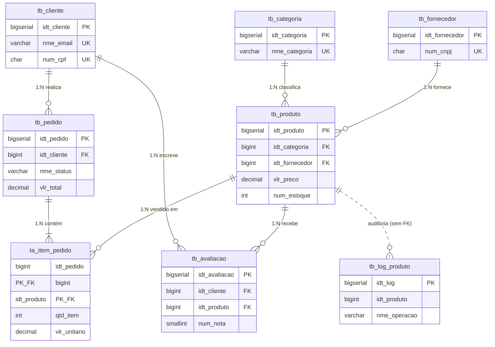

# Projeto Final BD-II — E-commerce de Eletrônicos (PostgreSQL)

> Scripts escritos para PostgreSQL 14+. **Não foram executados num servidor real durante a elaboração** — rode o `00_executar_tudo.sql` e ajuste o que o seu ambiente pedir.

## Ordem de execução

| # | Arquivo | Responsável |
|---|---|---|
| 1 | `01_ddl_estrutura.sql` | Aluno 1 |
| 2 | `02_dml_povoamento.sql` | Aluno 2 |
| 3 | `04_plpgsql_triggers.sql` / `04_plpgsql_procedures.sql` | Aluno 4 |
| 4 | `05_seguranca_transacoes.sql` | Aluno 4 |
| 5 | `03_otimizacao_indices.sql` (EXPLAIN antes/depois) | Aluno 2 |
| 6 | `06_consultas_dql.sql` (10 consultas) | Aluno 3 |

Os triggers vêm depois do povoamento de propósito: a carga em massa não baixa estoque nem gera log.

## MER

N:N resolvidas: **pedido × produto** (`ta_item_pedido`) e **cliente × produto** (`tb_avaliacao`).

## Conferência das métricas

| Requisito | Atendido |
|---|---|
| 6–10 tabelas | 8 |
| ≥ 4 relacionamentos 1:N | 7 (com FK) |
| 1–3 N:N com tabela associativa | 2 |
| 4–8 colunas de atributo por tabela | sim (4 a 6) |
| ≥ 1.000 registros / tabela principal ≥ 500 | ~5.440 / 1.500 pedidos |
| ≥ 3 CHECK | 9 |
| ≥ 2 UNIQUE | 5 (nome categoria, CNPJ, e-mail, CPF, avaliação cliente×produto) |
| Tabela de auditoria | `tb_log_produto` |
| 2 triggers / 2 funções-procedures | sim |
| 2 roles + transação explícita | sim |
| 10 consultas (4 JOIN / 3 CTE-subquery / 3 window) | sim |

## Relatório de desempenho (preencher após rodar o `03`)

| Consulta | Índice | Tempo antes (ms) | Tempo depois (ms) | Plano antes → depois | Buffers antes → depois |
|---|---|---|---|---|---|
| C1 pedidos do cliente por período | B-Tree (idt_cliente, dta_pedido) | | | Seq Scan + Sort → Index Scan | |
| C2 vendas de um produto | B-Tree (idt_produto) | | | Seq Scan → Index/Bitmap Scan | |
| C3 busca textual no nome | GIN tsvector | | | Seq Scan → Bitmap Index Scan | |

Com poucos milhares de linhas o PostgreSQL pode manter Seq Scan (a tabela cabe em poucas páginas). Para evidenciar o ganho, aumente o volume (até o máximo recomendado de 10.000 registros) ou use `SET enable_seqscan = off;` só na demonstração.
